# Switch `.xci` 提取 `.bnvib` 并转换为 Android 触觉 `.ogg` 实现流程文档

本文档描述了从 Nintendo Switch 游戏镜像（`.xci`）中提取 HD Rumble 振动文件（`.bnvib`），并将其合成为符合 Android 12+ **Audio-Coupled Haptics（音频耦合触觉）**规范的多声道 `.ogg` 文件、最终驱动手机线性马达的完整工程流程。

---

## 总体流程图

```mermaid
flowchart LR
    A[".xci 游戏镜像"] -->|"hactool / nstool<br/>(+ prod.keys)"| B["romfs/ 目录"]
    B -->|"直接扫描 / SARC 解包"| C[".bnvib 振动文件"]
    C -->|"二进制解析<br/>(Type / SampleRate / 4B帧)"| D["(amp, freq) 时序参数"]
    D -->|"48kHz 相位连续<br/>双频正弦合成"| E["3声道 PCM<br/>(L=0, R=0, Haptic)"]
    E -->|"Ogg Vorbis 编码<br/>+ ANDROID_HAPTIC=1"| F[".ogg 触觉音频"]
    F -->|"Android MediaPlayer<br/>setHapticChannelsMuted(false)"| G["手机线性马达 (LRA)"]
```



---

## 阶段一：从 `.xci` 中提取 `.bnvib` 文件

### 1.1 解密并提取 `romfs`
Switch 的 `.xci` 镜像内部包含加密的 NCA 分区，提取前需要准备从自己主机导出的密钥文件 `prod.keys`。

使用开源工具 `hactool`（或 `nstool`）：
1. **解包 XCI 获取 NCA 分区**：
   ```bash
   hactool -k prod.keys -t xci --outdir=./xci_extracted game.xci
   ```
2. **定位 Program NCA 并提取 `romfs`**：
   在 `./xci_extracted/secure/` 目录中，体积最大的 `.nca` 通常是主程序分区（Program NCA），从中提取文件系统：
   ```bash
   hactool -k prod.keys -t nca --romfsdir=./romfs ./xci_extracted/secure/<program_id>.nca
   ```

### 1.2 搜索并解包 `.bnvib`
提取出的 `./romfs` 中，`.bnvib` 存在两种存放形式：
- **裸文件**：直接位于 `romfs/` 的音效或特效目录中，可直接通过扩展名搜索：
  ```bash
  find ./romfs -type f -iname "*.bnvib"
  ```
- **打包在归档容器中**：任天堂第一方及众多引擎常将 `.bnvib` 打包在 `.sarc` 或 Yaz0 压缩的 `.szs` 归档内（部分第三方引擎可能封装在 Unity `AssetBundle` 或 Unreal `.pak` 中）。
  - 对于 `.sarc` / `.szs`，可使用 Python 的 `oead` / `sarc` 库或图形化工具 **Switch Toolbox** 批量解压后再按 `.bnvib` 后缀过滤。

---

## 阶段二：解析 `.bnvib` 二进制结构

`.bnvib`（Binary NX Vibration）采用 **Little-Endian（小端序）** 存储。

### 2.1 文件头解析
1. **通用头部（`0x00` – `0x05`）**：
   - `0x00`（1 byte）：**Vibration Type**（振动类型）
     - `0x04`：Normal（单次播放）
     - `0x0C`：Loop（循环播放）
     - `0x10`：Loop and Wait（带等待间隔的循环）
   - `0x04`（1 byte）：**Magic Number**，固定为 `0x03`。

2. **模式专属头（从 `0x06` 开始）**：
   - **`0x04`（Normal）**：`sample_rate_ms`（2B） → `vibsize`（4B） → 采样数据
   - **`0x0C`（Loop）**：`sample_rate_ms`（2B） → `loop_start`（4B） → `loop_end`（4B） → `vibsize`（4B） → 采样数据
   - **`0x10`（Loop & Wait）**：`sample_rate_ms`（2B） → `loop_start`（4B） → `loop_end`（4B） → `loop_wait`（4B） → `vibsize`（4B） → 采样数据

### 2.2 采样帧解码（每帧 4 字节）
采样数据由 `vibsize / 4` 个样本组成，每个样本的持续时间为 `sample_rate_ms` 毫秒：

| 字节索引 | 含义 | 物理量转换说明 |
| :--- | :--- | :--- |
| `byte[0]` | 低频段振幅 | 归一化至 $[0.0, 1.0]$（`byte[0] / 255.0`） |
| `byte[1]` | 低频段频率 | 非线性编码，按近似对数曲线 $f \approx 10 \times 2^{(B/32)}$ Hz 还原 |
| `byte[2]` | 高频段振幅 | 归一化至 $[0.0, 1.0]$（`byte[2] / 255.0`） |
| `byte[3]` | 高频段频率 | 非线性编码，还原为高频段 Hz |

*(注：对于 `0x0C` / `0x10` 循环类型，在离线转换为 `.ogg` 时，可根据需要展开循环区间的帧序列，或在结尾淡出。)*

---

## 阶段三：双频正弦波形合成（PCM）

为了让 Android 音频管线直接驱动线性马达，需要将离散的 `(amp_low, freq_low, amp_high, freq_high)` 帧序列合成为标准 **48000 Hz** 连续 PCM 波形。

### 3.1 相位连续合成与插值
在帧与帧切换时，**必须累加相位**而不能每帧把相位重置为 `0`，否则帧边界会产生尖锐的爆音（影响马达手感）：

- 设音频采样率 $f_s = 48000\text{ Hz}$，每帧包含采样点数 $N = \text{round}(f_s \times \text{sample\_rate\_ms} / 1000)$。
- 在第 $k$ 帧内的第 $i$ 个采样点（$0 \le i < N$），对振幅和频率做线性插值（平滑过渡到下一帧目标值）：
  $$\phi_{low} \leftarrow \phi_{low} + \frac{2\pi \cdot f_{low}(i)}{f_s}, \quad \phi_{high} \leftarrow \phi_{high} + \frac{2\pi \cdot f_{high}(i)}{f_s}$$
  $$s_{haptic}(i) = a_{low}(i)\sin(\phi_{low}) + a_{high}(i)\sin(\phi_{high})$$
- **限幅保护**：将 $s_{haptic}(i)$ 钳位（clamp）或软限幅到 $[-1.0, 1.0]$，避免双频峰值叠加导致削波失真。

---

## 阶段四：封装为 Android 触觉 `.ogg` 文件

Android 12+ 的音频耦合触觉支持在 Ogg Vorbis 文件中附加独立的触觉声道，并通过 Vorbis Comment 标签声明。

### 4.1 构造多声道 PCM（WAV 中转）
最稳定的封装方式是先生成 **3 声道 WAV**（32-bit float 或 16-bit PCM，48kHz）：
- **Channel 0（Left）**：全填 `0`（静音，避免手机扬声器发出嗡嗡声）
- **Channel 1（Right）**：全填 `0`（静音）
- **Channel 2（Haptic）**：写入阶段三合成的振动波形 $s_{haptic}$

*(注：若需要同时测试左右手柄合并后的独立通道，也可构造 4 声道：L=0, R=0, Haptic_A, Haptic_B。)*

### 4.2 编码为 Ogg Vorbis 并写入 `ANDROID_HAPTIC` 标签
1. **编码为 `.ogg`**：
   使用 `oggenc`（`vorbis-tools`）或 `ffmpeg` 将多声道 WAV 编码为 Ogg Vorbis（注意保留全部 3 个声道，不要被默认混音为立体声）：
   ```bash
   ffmpeg -i input_3ch.wav -c:a libvorbis -q:a 6 -ac 3 output_no_tag.ogg
   ```
2. **注入 Vorbis Comment 元数据**：
   使用 `vorbiscomment`（`vorbis-tools`）写入标签，告知 Android MediaExtractor 该文件末尾包含 1 个触觉声道：
   ```bash
   vorbiscomment -a -t "ANDROID_HAPTIC=1" output_no_tag.ogg output_haptic.ogg
   ```
   *(若使用 4 声道包含 2 个触觉通道，则设为 `ANDROID_HAPTIC=2`。)*

---

## 阶段五：Android 端加载与驱动马达

### 5.1 环境与支持度检查
在 Android App 中播放前，先检查当前设备与系统是否开启了音频耦合触觉通路：
1. 系统版本 **Android 12（API 31）及以上**（部分 Android 10/11 设备亦支持，但标准体系从 12 完善）。
2. 调用 `AudioManager.isHapticPlaybackSupported()` 确认 Audio HAL 已启用触觉路由。
3. 确保手机系统设置中的「媒体振动 / 触摸反馈」未被关闭。

### 5.2 解除触觉声道静音并播放
Android 默认会静音音频文件中的触觉声道，**必须**在 `AudioAttributes` 中显式调用 `setHapticChannelsMuted(false)`：

```kotlin
val audioAttributes = AudioAttributes.Builder()
    .setUsage(AudioAttributes.USAGE_MEDIA)
    .setContentType(AudioAttributes.CONTENT_TYPE_SONIFICATION)
    .setHapticChannelsMuted(false) // 关键：允许触觉声道路由到马达
    .build()

val mediaPlayer = MediaPlayer().apply {
    setAudioAttributes(audioAttributes)
    setDataSource(context, oggUri)
    prepare()
    start()
}
```

### 5.3 常见问题与排查
- **只看到播放进度在走，但手机不震**：
  1. 检查 `AudioManager.isHapticPlaybackSupported()` 是否返回 `false`。**注**：部分 OEM 厂商虽然搭载了优质 X 轴线性马达，但未在 `audio_policy_configuration.xml` 中接通 AOSP 标准音频触觉通路；此类设备需降级改用 `VibrationEffect.WaveformEnvelopeBuilder`（API 36+）或 `VibrationEffect.createWaveform()`（API 26+）。
  2. 使用 `vorbiscomment -l output_haptic.ogg` 检查 `ANDROID_HAPTIC=1` 是否正确写入音频流注释，且声道数确实为 3 声道。
- **高频段（>400Hz）震感偏弱**：
  属于正常物理现象。手机 Audio HAL 在驱动 LRA 前通常会经过针对马达谐振频点（约 150–230Hz）的带通滤波，高频细节在手机马达上的响应幅度天然弱于 Joy-Con 宽频马达。
